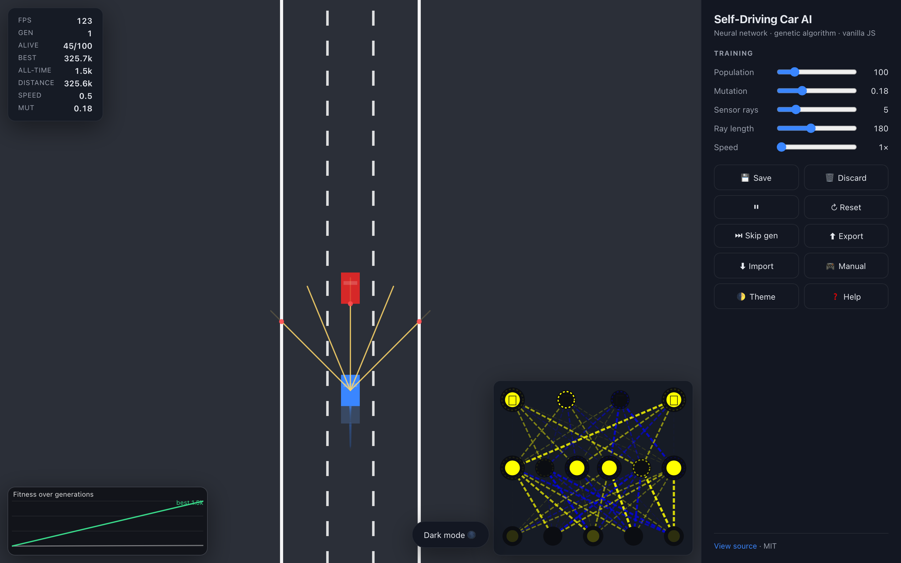
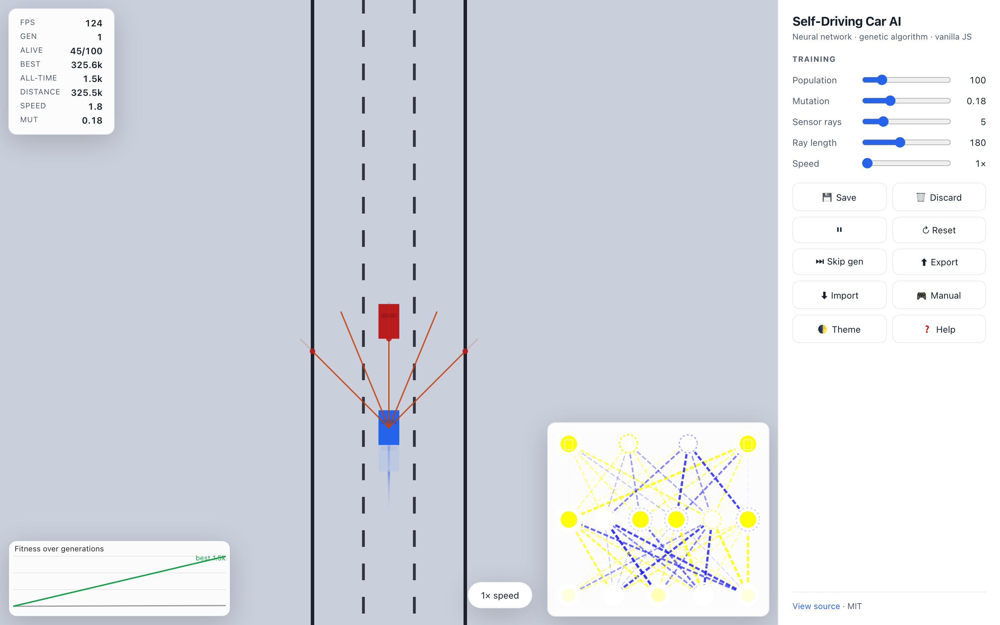

# 🚗 Self-Driving Car AI - Vanilla JS

> A neural-network self-driving car simulation trained with a **genetic algorithm** - written in pure vanilla JavaScript. **No libraries, no build step, no dependencies.** Just open `index.html`.

### 👉 [**Try the live demo →**](https://car-ai.halemogpa.com)

[](#license)
[](#)
[](#)
[](https://car-ai.halemogpa.com)

| Dark | Light |
| :---: | :---: |
|  |  |

---

## ✨ Highlights

- 🧠 **Hand-rolled neural network** - input layer (5 sensor rays) → 6 hidden neurons → 4 outputs (up / left / right / down). Step-activated, mutation-only training.
- 🧬 **Genetic algorithm** with elitism + adaptive mutation rate that auto-increases when training plateaus
- 📊 **Live fitness chart** plotting best vs average fitness across generations
- 📡 **Sensor visualization** - see exactly what each ray detects in real time
- 🎛️ **Live control panel** - tune population, mutation, sensor rays, ray length, and sim speed without reloading
- ⏩ **Speed multiplier** (1× / 2× / 5× / 10×) for fast-forward training
- 🎮 **Manual driving mode** with spawn invulnerability and auto-respawn on crash
- 📱 **Mobile-ready** - responsive layout, on-screen touch D-pad
- 💾 **Save / load brains** to localStorage *and* to/from JSON files (drag-and-drop supported)
- 🌗 **Light + dark theme** with system-preference detection
- ✨ **Visual polish** - smooth camera follow, tire trails, crash particle bursts, animated network weights with thickness ∝ |w|
- 📈 **HUD overlay** - FPS, generation, alive count, best/all-time fitness, distance, speed, current mutation
- 🎹 **Hotkeys** for everything

---

## 🚀 Live demo

**👉 [car-ai.halemogpa.com](https://car-ai.halemogpa.com)**

Open it on a phone or desktop - the layout adapts. The simulation auto-runs with whichever brain has been saved, and you can toggle 🎮 Manual to drive yourself.

A pre-trained champion brain is committed at [`champion-brain.json`](./champion-brain.json) - drop it onto the page (or click ⬇ Import) to load a driver that survived 325k pixels (about 6,500 car-lengths) without crashing.

---

## 🧠 How it works

### The car
Each car has a fixed-topology neural network: **N sensor rays → 6 hidden neurons → 4 output neurons** (up / left / right / down). Sensor rays cast forward in a fan and report distance to the nearest obstacle (other car or road border). The network's outputs drive the controls.

### The genetic algorithm
- A population of N (default **100**) cars all start in lane center with brains derived from the all-time best.
- **Car 0** keeps the champion brain unmutated (**elitism**).
- All other cars get mutated copies - `weight = lerp(weight, random(-1,1), mutationRate)`.
- A generation ends when **every car crashes** (or you hit ⏭ Skip gen).
- The car with the highest **fitness** (`distance + topSpeed × 5 − crashPenalty`) becomes the new champion.
- If best fitness fails to improve for 3 generations, mutation rate **automatically increases** to escape the plateau.

### What's drawn
- **Driving canvas** - road, traffic, the ghost-faded population, the highlighted best car with its sensors, tire trails, and crash particles.
- **Network canvas** - the best car's brain. Connection thickness is proportional to weight magnitude, color shows sign, node radius pulses with activation, and the bias rings show each neuron's threshold.
- **Fitness chart** - best (green) and average (faint white) fitness per generation.

---

## 🎛️ Controls

| Key | Action |
| --- | --- |
| `P` | Pause / resume |
| `R` | Reset simulation |
| `S` | Save best brain |
| `D` | Discard saved brain |
| `1` `2` `3` `4` | Speed 1× / 2× / 5× / 10× |
| `M` | Toggle manual driving |
| `T` | Toggle dark / light theme |
| `F` | Fullscreen |
| `?` | Open help |
| `Esc` | Close help |
| `↑ ↓ ← →` / `WASD` | Drive in manual mode |

You can also use the sidebar buttons, drag-and-drop a `brain*.json` anywhere on the page to load a brain, or use the export button to download one.

---

## 🛠️ Run locally

The project is **pure static** - no build step, no install. Pick whichever you prefer:

```sh
# 1) Just open it
open index.html        # macOS
xdg-open index.html    # Linux

# 2) Or serve it (recommended for cleaner caching)
npx serve .            # then visit http://localhost:3000
python3 -m http.server # then visit http://localhost:8000
```

> **Tip:** If you open via `file://`, everything still works (no fetch/CORS calls), but a local server makes hard-refreshes faster and is closer to the deployed environment.

---

## 📁 Project structure

```
.
├── index.html        # Layout: stage, sidebar, HUD, modal, D-pad
├── main.css          # Theming via CSS variables (dark + light), responsive grid
├── main.js           # Orchestration: canvas sizing, animate loop, camera follow
├── simulation.js     # Genetic algorithm, traffic spawner, generations
├── ui.js             # Sidebar bindings, hotkeys, theme, modal, drag-drop
├── chart.js          # Mini fitness line chart
├── particles.js      # Tire trails + crash explosion bursts
├── storage.js        # Safe localStorage + JSON brain export/import
├── network.js        # NeuralNetwork + Level (step activation, mutate, clone)
├── visualizer.js     # Network visualizer with pulsing nodes
├── car.js            # Car (physics, fitness, distance, polygon, draw)
├── controls.js       # Keyboard + on-screen D-pad inputs
├── sensor.js         # Ray casting + obstacle detection
├── road.js           # Multi-lane road with dashed lane lines
├── utils.js          # lerp, clamp, polysIntersect, getRGBA, etc.
├── vercel.json       # Static deploy config + asset caching
└── README.md
```

About **~2300 lines of hand-written code**, zero runtime dependencies.

A pre-trained brain is included as [`champion-brain.json`](./champion-brain.json).

---

## 🚀 Deploy

### Vercel (one click)

1. Push this repo to GitHub.
2. Go to [vercel.com/new](https://vercel.com/new) and import the repo.
3. Click **Deploy**. Vercel auto-detects it as a static site.

Or via CLI:

```sh
npm i -g vercel
vercel --prod
```

The included `vercel.json` enables `cleanUrls`, sets long-lived immutable caching for `*.js / *.css / *.svg`, and adds `X-Content-Type-Options: nosniff`.

### GitHub Pages

Settings → Pages → Source: `main`, Folder: `/ (root)`. Done.

### Any static host

Drop the folder into Netlify drop, Cloudflare Pages, S3, or even an `nginx` `root` - there's nothing to build.

---

## 🔬 Tech notes

- **No libraries.** Not even a polyfill. Modern browsers only.
- **Retina-aware** - every canvas is scaled by `devicePixelRatio` so it stays crisp on Retina/Hi-DPI displays.
- **`ResizeObserver`** keeps canvas dimensions in sync with CSS layout without rAF-side effects.
- **Storage is wrapped** with try/catch - runs cleanly in private mode / when storage is disabled.
- **Procedural traffic** - instead of a hardcoded list of hundreds of off-screen cars, traffic is procedurally generated as the leader advances and recycled when it falls far behind.
- **Adaptive mutation** - automatically explores more aggressively when training plateaus, then settles back when a new best is found.
- **Fitness function** rewards forward progress *and* sustained top speed but penalizes crashes - preventing the classic reward-hack of "drive fast straight into a wall."

---

## 🙌 Credits

Inspired by **Radu Mariescu-Istodor**'s legendary [*Self-Driving Car - No Libraries*](https://www.youtube.com/watch?v=Rs_rAxEsAvI) tutorial.
This rebuild adds the genetic-algorithm training loop, live UI, polish, and deploy story on top.

---

## 📜 License

MIT - see [LICENSE](LICENSE) or use freely with attribution. Pull requests welcome.
