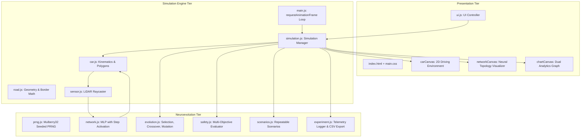

# EvoSafe System Architecture

## 1. Architectural Overview
EvoSafe is a research-oriented, web-native autonomous driving simulator built on Vanilla JavaScript, HTML5 Canvas, and modern Web APIs. It provides an empirical playground for evaluating Neuroevolution (NE) and Genetic Algorithms (GA) applied to vehicle path planning and collision avoidance under stochastic driving environments.

---

## 2. Component Directory & Module Responsibilities

| File | Primary Responsibility | Key Interfaces / Exports |
| :--- | :--- | :--- |
| `prng.js` | Mulberry32 32-bit PRNG with deterministic seeding and Gaussian sampling | `PRNG`, `DefaultPRNG` |
| `network.js` | Multi-Layer Perceptron (MLP) with step activation ($sum > bias$) | `NeuralNetwork`, `Level` |
| `road.js` | Continuous vertical 3-lane road geometry, borders, and center coordinates | `Road` |
| `sensor.js` | Multi-ray LiDAR perception system with segment-segment intersection | `Sensor` |
| `car.js` | Rigid-body kinematic vehicle model, polygon vertex generation, and collision detection | `Car`, `ControlMode` |
| `particles.js` | Visual crash particle bursts and tire skid mark rendering | `ParticleSystem` |
| `evolution.js` | Genetic algorithm engine supporting Tournament Selection, Uniform Crossover, and Diversity metrics | `EvolutionEngine` |
| `safety.js` | Objective safety evaluator computing Time-to-Collision (TTC), near-misses, and composite safety fitness | `SafetyEvaluator` |
| `scenarios.js` | Controlled benchmark scenarios (Highway, Commute, Chicane, Fog) with fixed seeds | `ScenarioManager`, `ScenarioType` |
| `experiment.js` | Telemetry logging, statistical aggregation (Mean $\pm$ Std Dev), and CSV export | `ExperimentManager` |
| `chart.js` | Real-time dual-series canvas charting (Fitness Dynamics vs. Safety & Diversity) | `AnalyticsCharts` |
| `visualizer.js` | Live interactive neural network topology inspector with synaptic weights | `Visualizer` |
| `simulation.js` | Simulation lifecycle manager coordinating physics stepping, generation transitions, and mode switching | `Simulation` |
| `ui.js` | Dashboard UI controller, hotkey dispatcher, slider bindings, and toast notifications | `UI` |
| `main.js` | Application entry point and Retina-aware animation loop | Main IIFE |

---

## 3. Data Flow & Generational Lifecycle

1. **Step Phase (`simulation.step()`):**
   - Each active vehicle updates its kinematic position:
     $$x_{t+1} = x_t - \sin(\theta) \cdot v$$
     $$y_{t+1} = y_t - \cos(\theta) \cdot v$$
   - LiDAR rays cast outward; intersections with road borders and dynamic traffic are calculated.
   - Sensor inputs $[s_0 \dots s_4] \in [0, 1]$ are fed forward through the neural network.
   - Discrete binary controls $[up, left, right, down] \in \{0, 1\}$ are emitted.
   - Polygon intersections are tested against road borders and traffic vehicles (`polysIntersect`).
   - If a collision occurs, the car is marked `damaged = true` and frozen.
   - Safety telemetry (near-misses, lane centering error, min distance, TTC) is updated.

2. **Transition Phase (`simulation.nextGeneration()`):**
   - Triggered when all vehicles in the current batch have crashed (`isBatchDone()`).
   - Evaluates each car's fitness score based on active mode (**Baseline** vs. **EvoSafe**).
   - Updates all-time best champion brain in LocalStorage if a new high score is achieved.
   - `EvolutionEngine.evolve()` is called:
     - Elites are retained.
     - Parents are selected via Tournament Selection ($k=3$).
     - Uniform Crossover combines synaptic weights from two parents.
     - Gaussian/Lerp mutation perturbs weights within $[-2, 2]$.
     - Genetic diversity $\mathcal{D}$ across all genomes is calculated.
   - `ExperimentManager` records generational statistics.
   - Next generation population is instantiated and traffic is reset deterministically.
